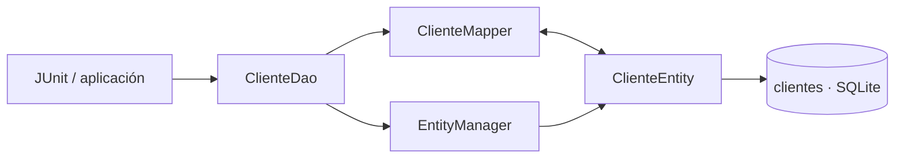

# Arquitectura DAO: modelo, entidad y mapper

## Objetivos de aprendizaje

Al terminar podrás diferenciar una clase de modelo, una entidad JPA, un mapper y un DAO; identificar quién usa `EntityManager`; y explicar por qué los métodos públicos devuelven modelos en vez de entidades.

## Diagrama de capas



- **`model.Cliente`**: clase Java normal, sin anotaciones JPA; getters, setters, constructor vacío y constructor completo.
- **`entity.ClienteEntity`**: clase JPA que representa `clientes`; su `dni` es clave `String` **asignada manualmente**.
- **`mapper.ClienteMapper`**: transforma entre modelos y entidades, sin consultar la base de datos.
- **`dao.ClienteDao`**: implementa operaciones con `EntityManager` y entrega `Cliente` a quien lo llama.

## Modelo (clase, no `record`)

```java
package es.examen.sportrent.model;

public class Cliente {
    private String dni;
    private String nombre;
    private String email;
    private String telefono;

    public Cliente() { }

    public Cliente(String dni, String nombre, String email, String telefono) {
        this.dni = dni;
        this.nombre = nombre;
        this.email = email;
        this.telefono = telefono;
    }

    public String getDni() { return dni; }
    public void setDni(String dni) { this.dni = dni; }
    public String getNombre() { return nombre; }
    public void setNombre(String nombre) { this.nombre = nombre; }
    public String getEmail() { return email; }
    public void setEmail(String email) { this.email = email; }
    public String getTelefono() { return telefono; }
    public void setTelefono(String telefono) { this.telefono = telefono; }
}
```

## Entidad JPA

```java
@Entity(name = "ClienteEntity")
@Table(name = "clientes")
public class ClienteEntity {
    @Id
    @Column(name = "dni", nullable = false)
    private String dni;

    @Column(nullable = false)
    private String nombre;
    private String email;
    private String telefono;

    public ClienteEntity() { }
    // Getters y setters de los cuatro atributos.
}
```

Importa `jakarta.persistence.*` en las entidades. **No coloques `@GeneratedValue` en `dni`.** La clave `EquipoEntity.codigo` también será `String` manual; `AlquilerEntity.id` será `Long` autogenerado.

## Mapper

```java
public final class ClienteMapper {
    private ClienteMapper() { }

    public static Cliente toModel(ClienteEntity e) {
        if (e == null) return null;
        return new Cliente(e.getDni(), e.getNombre(), e.getEmail(), e.getTelefono());
    }

    public static ClienteEntity toEntity(Cliente m) {
        if (m == null) return null;
        ClienteEntity e = new ClienteEntity();
        e.setDni(m.getDni());
        e.setNombre(m.getNombre());
        e.setEmail(m.getEmail());
        e.setTelefono(m.getTelefono());
        return e;
    }
}
```

En el ejemplo usamos constructor vacío `public` para que el mapper de otro paquete pueda crear la entidad. JPA también admite un constructor sin argumentos `protected`, pero en ese caso el mapper necesitaría otro constructor o una factoría accesible.

## Ejercicio guiado

1. Dibuja la ruta `List<Cliente>` desde el DAO hasta el test.
2. Explica por qué `ClienteEntity` no debe escapar del DAO.
3. Escribe dos mappers de ida y vuelta y comprueba sus valores con `assertEquals`.
4. Señala dónde aparece `@Entity`, dónde aparece `@Id` y quién abre `EntityManager`.

<details><summary>Autoevaluación: ¿en qué paquete se realiza `persist`?</summary>

En `dao`, mediante el `EntityManager`. El mapper solo transforma objetos.
</details>

**Siguiente:** [tres tablas y relaciones](/orm/leccion30/).
