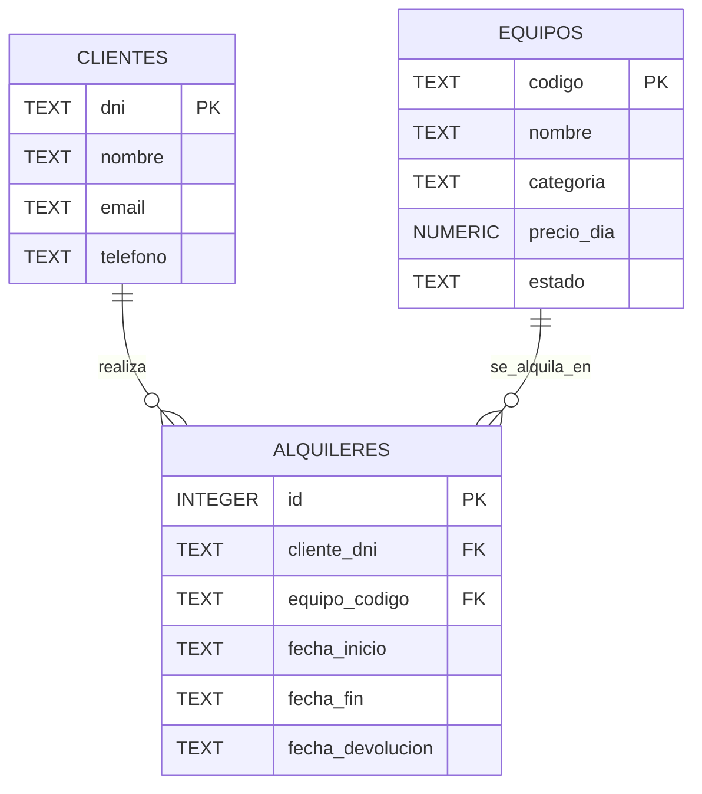

# SportRent: tablas, relaciones y claves

## Modelo entidad-relación



Cada alquiler corresponde a **un** cliente y **un** equipo; un cliente o equipo puede aparecer en muchos alquileres.

## DDL ilustrativo SQLite

```sql
PRAGMA foreign_keys = ON;
CREATE TABLE clientes (
    dni TEXT PRIMARY KEY,
    nombre TEXT NOT NULL,
    email TEXT,
    telefono TEXT
);
CREATE TABLE equipos (
    codigo TEXT PRIMARY KEY,
    nombre TEXT NOT NULL,
    categoria TEXT NOT NULL,
    precio_dia NUMERIC NOT NULL CHECK (precio_dia > 0),
    estado TEXT NOT NULL
);
CREATE TABLE alquileres (
    id INTEGER PRIMARY KEY,
    cliente_dni TEXT NOT NULL REFERENCES clientes(dni),
    equipo_codigo TEXT NOT NULL REFERENCES equipos(codigo),
    fecha_inicio TEXT NOT NULL,
    fecha_fin TEXT NOT NULL,
    fecha_devolucion TEXT
);
```

> Este esquema es **didáctico**. Si el ejercicio descargado incorpora otras columnas o restricciones, prevalece su propio `schema.sql`.

## Relaciones JPA

```java
@Entity(name = "AlquilerEntity")
@Table(name = "alquileres")
public class AlquilerEntity {
    @Id
    @GeneratedValue(strategy = GenerationType.IDENTITY)
    private Long id;

    @ManyToOne(fetch = FetchType.LAZY)
    @JoinColumn(name = "cliente_dni", nullable = false)
    private ClienteEntity cliente;

    @ManyToOne(fetch = FetchType.LAZY)
    @JoinColumn(name = "equipo_codigo", nullable = false)
    private EquipoEntity equipo;

    @Column(name = "fecha_inicio")
    private String fechaInicio;
    @Column(name = "fecha_fin")
    private String fechaFin;
    @Column(name = "fecha_devolucion")
    private String fechaDevolucion;
    protected AlquilerEntity() { }
    // Resto de accesores y constructores.
}
```

Las fechas se representan como `String` de formato **`yyyy-MM-dd`**. En SQLite se almacenan como `TEXT`: esto simplifica el tema y permite comparaciones lexicográficas cuando **todas** están normalizadas a diez caracteres. Valida que el dato sea una fecha real si esa condición forma parte del contrato; una simple cadena con guiones no garantiza una fecha válida.

## Ejercicio

1. Identifica PK y FK. ¿Qué dos claves se generan manualmente?
2. ¿Puede existir un alquiler de un equipo inexistente? Relaciónalo con la integridad referencial.
3. Escribe una inserción SQL con una cadena de fecha válida y una inválida.
4. Explica qué puede ocurrir si SQLite no tiene activado `PRAGMA foreign_keys` para cada conexión.

<details><summary>Autoevaluación: ¿qué devuelve un listado público de `AlquilerDao`?</summary>

Una `List<Alquiler>` con **modelos**, no una `List<AlquilerEntity>`.
</details>

**Siguiente:** [CRUD con `EntityManager`](/orm/leccion31/).
